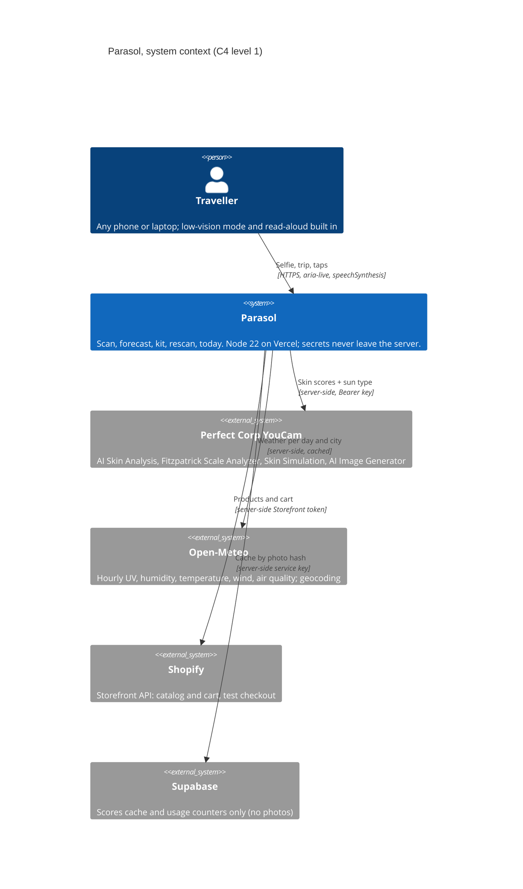

# PARASOL

**Your skin, on the road. One selfie, any trip: a day-by-day skin forecast for every skin, from albinism to deep skin.**

[](https://github.com/imprint-hash/parasol/actions/workflows/ci.yml)
[](#live-surfaces)
[](LICENSE)
[](package.json)
[](test/)
[](#youcam-api-integration-the-call-flow)

Built for the **[YouCam API Skin AI & eCommerce VTO Hackathon](https://youcam-api-skin-ai-ecommerce.devpost.com/)** (Perfect Corp), Skin AI track.

Built on the Perfect Corp YouCam **AI Skin Analysis** and **Fitzpatrick Scale Analyzer** APIs. Parasol speaks weather and skincare, never medicine: burn times are labelled estimates, and every rule that touches the sun is unit-tested so deep skin is never told it can skip sunscreen.

## Quick access

| To verify... | Go here |
|---|---|
| **Try it, zero setup** | The live app (link below): tap **Try the demo**, no selfie, no account |
| **The demo video** | [Demo video](#live-surfaces) (real app, live API, real Shopify checkout) |
| **Claims are wired, not aspirational** | [`docs/FACTS.md`](docs/FACTS.md): every claim on this page, with the file that does it |
| **It reproduces on your machine** | [Quickstart](#quickstart): Node 22, zero dependencies, `npm test` passes with zero keys |
| **Safety is engineered** | [Guardrails](#guardrails) + `test/attack.test.js` (63 attack tests) and `test/rules.test.js` |

## Live surfaces

| Surface | URL |
|---|---|
| Web app (mobile-first, add to home screen) | _link added after deploy_ |
| Demo video | _link added before submission_ |
| Demo shop (Shopify, test payments) | parasol-demo.myshopify.com |
| Code | https://github.com/imprint-hash/parasol |

Checkout uses Shopify's test gateway: card number `1`, any future date, any CVV. No real money moves.

## How it works (the brief's three moments)

The Skin AI brief says people wonder about their skin "right before a purchase, right after a bad breakout, or right when they're standing in front of a mirror". Parasol is built around exactly those moments, on a trip.

1. **Right before a purchase: before you fly** (`/scan` → `/trip` → `/forecast` → `/kit`). One selfie gives your skin type (T-zone and cheeks read separately), your concerns and your sun type. Add your cities and dates. Parasol pulls the real hourly weather for each day and writes a forecast for *your* skin: humidity, cold, dry cabin air, UV, and a **burn clock** ("you may start to burn in about 10 to 25 minutes at 1 pm"). Then it builds a carry-on kit of real products, each with the reason it was picked, and checks out on Shopify.
2. **Right after a bad breakout: day 3 in a new city** (`/rescan`). Rescan in the hotel. Parasol compares you with your pre-trip scan, shows only changes bigger than normal day-to-day noise, names the likely cause from the actual weather since you landed ("84% humidity and 31 °C on both days"), and gives a "tonight" checklist plus a safety line.
3. **In front of the mirror: every morning** (`/today`). Today's routine for today's weather in the city's own time zone, a read-aloud briefing, and a **sun timer**: tap "I'm going out" and it counts down to your next reapply (2 hours, or 40/80 minutes after water or sweat).

## YouCam API integration (the call flow)

`src/youcam.js` is the one YouCam client. `src/scan.js` registers the photo once with `POST /s2s/v2.0/file/skin-analysis`, PUTs the bytes to the presigned URL, then runs two tasks **in parallel** from the same `file_id`:

- **AI Skin Analysis**: `POST /s2s/v2.0/task/skin-analysis` with 9 SD actions (`skin_type`, `oiliness`, `moisture`, `acne`, `redness`, `pore`, `age_spot`, `texture`, `radiance`, `format: json`), polled at `GET /s2s/v2.0/task/skin-analysis/{task_id}` until success. `skin_type` comes back per region (`whole`, `t_zone`, `u_zone`), which is how Parasol tells oily, dry, combination and normal apart.
- **Fitzpatrick Scale Analyzer**: `POST /s2s/v2.0/task/fitzpatrick-scale-analyzer/pre-process` (face detection: also catches group photos and no-face shots for free), then `POST /s2s/v2.0/task/fitzpatrick-scale-analyzer` with `version: "1.0"`, polled until it returns `fitzpatrick_scale` I to VI. That drives the burn clock.

Two more YouCam tools built the demo:

- **AI Image Generator V2** (`POST /s2s/v2.0/task/text-to-image/youcam`): the demo faces for Sam and Ada are AI-generated, not real people.
- **AI Skin Simulation** (`POST /s2s/v2.0/task/skin-simulation`): Ada's "Day 3 in Lagos" photo is simulated from her baseline face, then analysed for real, and the app says so.

The Bearer key lives only in server env. Units are only spent when a task succeeds, so the server always polls to the end. Every scan result is cached by the photo's SHA-256, so the same photo never costs twice, and the demo replays real captured results from `data/demo/` at zero cost. Response shapes are pinned by the stub in `test/helpers/youcam-stub.js`.

**One honest finding:** on the AI-generated face of a woman with albinism, the Fitzpatrick analyzer returned **type V**. Parasol keeps the real reading and shows it, then uses **type I** (the most protective) when the person says they have albinism: "YouCam read type V; with albinism Parasol uses type I." The "I have albinism" switch and "Not right? Choose your sun type" are always one tap away.

## The problem

Your routine works at home, then you land somewhere new and your skin turns oily, tight, broken out or burnt. Weather apps show a UV number and a humidity percentage, but nobody tells you what they mean for *your* skin, today, in this city.

Sun advice also forgets both ends of the scale. People with albinism and very fair skin can burn in minutes under a strong sun, and many also have low vision and light sensitivity, so small, bright beauty apps are hard to use. People with deep skin are often told they "don't need much sunscreen", when sun and heat leave dark marks that take months to fade, and many sunscreens leave a white cast.

## What it does

- **Reads your skin and your sun type** from one selfie, with YouCam: skin type by zone, 8 concerns with masks, sun type I to VI. A manual path exists for anyone who'd rather not scan.
- **Forecasts your trip, day by day**, from real Open-Meteo weather: up to 16 days of forecast, "typical (last year)" beyond that, cabin air on flight days, air quality.
- **Gives every sun type its own advice**: a burn clock and protect hours for very fair skin and albinism; dark marks and no-white-cast sunscreen first for deep skin.
- **Builds a carry-on kit** of 32 real products (SPF, moisturisers, cleansers, lip SPF, mist, after-sun, UPF 50+ hat and sleeves, UV400 sunglasses), each claim sourced in `products/SOURCES.md`, and checks out through a real Shopify cart.
- **Explains a reaction** after a rescan, with the weather that likely caused it and what to do tonight.
- **Works for low vision**: big text, AAA contrast mode, a gentle dark theme for light-sensitive eyes, read-aloud on every page, screen-reader landmarks, 48 px targets.

## Architecture



- **Node 22, plain ES modules, no framework, no npm dependencies.** One router (`src/router.js`) serves Vercel (`api/index.js`) and local (`bin/serve.mjs`).
- **Rules you can read:** `src/rules.js` is one table of named rules with named thresholds; `src/burn.js` holds the burn clock (UV index 1 = 0.025 W/m² erythemal, WHO Global Solar UV Index guide; approximate MED ranges by Fitzpatrick type, rounded down to stay cautious); `src/rescan.js` names causes only when the weather supports them.
- **Kit matching** (`src/kit.js`) is a pure function over the Shopify catalog's tags: hard filters (type, under 100 ml for carry-on), then a transparent score. Each pick shows its reasons.
- **Front end:** static HTML, CSS and ES modules in `public/`, designed from the Stitch reference, mobile-first, installable (web manifest).

## Quickstart

Requires Node 22. No install step: there are no dependencies.

```bash
git clone https://github.com/imprint-hash/parasol.git
cd parasol
npm test        # 200+ offline tests: YouCam, Shopify and Open-Meteo are stubbed
npm start       # http://localhost:3090 (demo works with zero keys)
```

Add keys to `.env` for live scans and the live shop.

## Environment variables (server-side only)

```
YOUCAM_API_KEY=              # Perfect Corp YouCam Bearer key
SHOPIFY_STORE_DOMAIN=        # e.g. parasol-demo.myshopify.com
SHOPIFY_STOREFRONT_TOKEN=    # Storefront API public token (kept server-side anyway)
SHOPIFY_STORE_PASSWORD=      # optional: shown next to Checkout
SUPABASE_URL=                # scores cache + counters (falls back to a local file)
SUPABASE_SERVICE_ROLE_KEY=
PARASOL_SECRET=              # 32+ random bytes: delete tokens and hashed IPs
CRON_SECRET=                 # daily cleanup job
LIVE_SCANS=on                # kill switch
LIVE_SCANS_PER_DAY=15        # daily cap on live YouCam scans
UNITS_FLOOR=150              # never spend below this many YouCam units
YOUCAM_SKIN_TONE=0           # Skin Tone Analysis wired in, off (20 units a scan)
```

## Guardrails

- **Not medical advice**, on every page. Burn times are shown as a range and labelled "Estimate. Not medical advice." The rescan always shows a safety line: blistering, fever, swelling near the eyes or a spreading rash means a pharmacist or doctor.
- **Deep skin is never told to skip sunscreen**, at any UV. A test checks it.
- **Albinism is never under-protected:** the switch forces sun type I with the most cautious burn range, even when the analyzer reads otherwise.
- **Privacy:** the photo is resized and re-encoded in the browser (dropping location data), sent to YouCam for analysis, and never stored or hosted by Parasol. The server keeps only scores, keyed by the photo's hash, for up to 30 days, and **My data → Delete everything** removes them.
- **Honest copy:** no "on-device", "dermatologist verified" or invented products. Every product claim traces to a source in `products/SOURCES.md`; the shop says "Demo shop. Not affiliated with these brands."
- **Unit safety:** consent must be explicit; 3 live scans per person per hour, a daily cap, a unit floor and a kill switch; identical photos never run twice.
- **Attack-tested:** `test/attack.test.js` covers consent, unit-burn abuse, cache poisoning, input validation, secret leaks, YouCam error mapping, privacy and headers.

## Status

Built in four days for the November 2026 round. Demo personas use AI-generated faces with real YouCam results; the live scan, forecast, kit and Shopify checkout run on real APIs.

## License

MIT, see [LICENSE](LICENSE). Weather: Open-Meteo (CC BY 4.0). Product image: Open Beauty Facts (CC BY-SA). Fonts: Literata and Atkinson Hyperlegible Next (SIL OFL 1.1). Skin AI: YouCam API by Perfect Corp. Details in [`THIRD_PARTY_NOTICES.md`](THIRD_PARTY_NOTICES.md).
